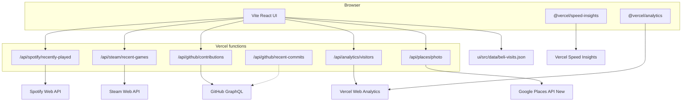
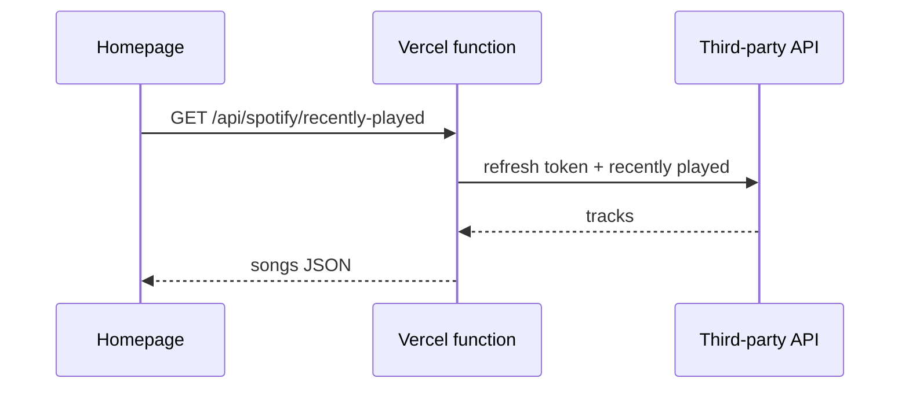
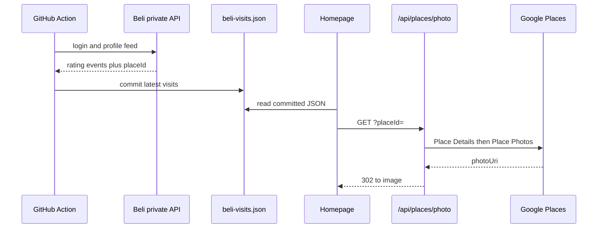

# React + Vite

This project is a Vite + React + TypeScript personal site with Spotify, GitHub, Steam, and Beli activity widgets, Google Places thumbnails, a footer visitor count from Vercel Web Analytics, and Vercel Speed Insights.

The repo is a pnpm workspace:

- `ui/` — Vite + React frontend (the versioned `devesh-portfolio` package)
- `api/` — Vercel Node functions at the git root so the UI can call same-origin `/api/*`. Helper and test files must start with `_` so they do not count toward the Hobby 12-function limit.

Do not set Vercel’s Root Directory to `ui/`; keep it at the repository root so `/api` stays on the same project.

## Integrations

The homepage talks to several third-party services. Most widgets call a same-origin Vercel function at request time. Beli is the exception: visits are committed as JSON, then restaurant photos are resolved live from Google Places.



`/api/github/recent-commits` exists but the Activity column is off (`SHOW_RECENT_COMMITS`). Helpers and tests under `api/` start with `_` so they do not count as Hobby functions.

| Surface | Source | Runtime path | Secrets |
| --- | --- | --- | --- |
| Recent songs | Spotify | `/api/spotify/recently-played` | `SPOTIFY_CLIENT_ID`, `SPOTIFY_CLIENT_SECRET`, `SPOTIFY_REFRESH_TOKEN` |
| GitHub heatmap | GitHub GraphQL | `/api/github/contributions` | `GITHUB_TOKEN`, optional `GITHUB_USERNAME` |
| Recent games | Steam | `/api/steam/recent-games` | `STEAM_WEB_API_KEY`, `STEAM_ID` |
| Recent restaurants | Beli feed, committed daily | `beli-visits.json` | `BELI_EMAIL`, `BELI_PASSWORD` in GitHub Actions only |
| Restaurant photos | Google Places | `/api/places/photo` | `GOOGLE_PLACES_API_KEY` |
| Unique visitors | Vercel Web Analytics | `/api/analytics/visitors` | `VERCEL_TOKEN`, plus injected project/team ids |
| Page views / CWV | Vercel | `@vercel/analytics`, `@vercel/speed-insights` | none |

### Live widget request

Spotify, Steam, GitHub, visitors, and Places all follow the same pattern: the browser calls `/api/*`, the function holds the secret, and the response is cached on Vercel.



### Beli visits and Place photos

Beli has no public API, so credentials never go on Vercel. A daily GitHub Action logs in, writes the latest rating events to `ui/src/data/beli-visits.json`, and commits only when the list changes. Photo resource names expire, so thumbnails are fetched later from the stored `placeId`.



See [`scripts/beli-fetch-visits.md`](scripts/beli-fetch-visits.md) for the refresh command and Action secrets.

## Run locally

From the project root:

```bash
pnpm install
pnpm dev
```

This starts the Vite dev server for `ui/`, usually at `http://localhost:5173/`.

## Run with API routes

The activity section calls serverless API routes for Spotify, GitHub, and Steam.
To test those locally, use the Vercel dev server:

```bash
pnpm run dev:full
```

This expects the following env vars in `.env` or `.env.local`:

```bash
SPOTIFY_CLIENT_ID=...
SPOTIFY_CLIENT_SECRET=...
SPOTIFY_REFRESH_TOKEN=...
GITHUB_USERNAME=DeveshKrishan
# Optional, helps with GitHub rate limits. Private repos are never included.
GITHUB_TOKEN=...
STEAM_WEB_API_KEY=...
STEAM_ID=76561198...
# Optional alternative to STEAM_ID:
# STEAM_VANITY_URL=yourname
# Restaurant thumbnails on the Beli widget. Enable Places API (New) in Google Cloud.
GOOGLE_PLACES_API_KEY=...
# Required to show the footer visitor count. Create at https://vercel.com/account/tokens
VERCEL_TOKEN=...
# Injected automatically on Vercel. Set locally for `vercel dev`.
VERCEL_PROJECT_ID=...
# Team projects only. Personal accounts can omit this.
# VERCEL_TEAM_ID=team_...
```

If you only run `pnpm dev`, the UI will still load, but the API routes will not be available locally.

## Visitor count

The footer shows unique visitors from [Vercel Web Analytics](https://vercel.com/docs/analytics) since analytics was enabled (production only).

1. Enable Web Analytics: `npx vercel project web-analytics`
2. Create an access token at [vercel.com/account/tokens](https://vercel.com/account/tokens). `vercel tokens add` fails if the CLI is logged in with **Sign in with Vercel**.
3. Add it for every environment:

   ```bash
   printf '%s' 'YOUR_TOKEN' | npx vercel env add VERCEL_TOKEN production,preview --sensitive --yes
   printf '%s' 'YOUR_TOKEN' | npx vercel env add VERCEL_TOKEN development --no-sensitive --yes
   ```

   Also put `VERCEL_TOKEN=...` in local `.env`.
4. `VERCEL_PROJECT_ID` and `VERCEL_TEAM_ID` can be added with `vercel env add`. On Vercel, `VERCEL_PROJECT_ID` and a `team_` `VERCEL_ORG_ID` are also injected automatically.

The site sends page views with `@vercel/analytics`. Counts stay at zero until Web Analytics is enabled and production traffic arrives after the tracking script is deployed.

## Steam setup

See [`scripts/steam-resolve-id.md`](scripts/steam-resolve-id.md) for full steps. In short:

1. Get a Web API key at [steamcommunity.com/dev/apikey](https://steamcommunity.com/dev/apikey).
2. Find your SteamID64 (from your profile URL or via vanity URL resolution).
3. Set **Game details** to **Public** in [Steam privacy settings](https://steamcommunity.com/my/edit/settings).

The Steam widget shows games played in the **last 2 weeks**, plus a compact achievement count when the game supports Steamworks stats.

## Changesets workflow

This project uses [Changesets](https://github.com/changesets/changesets) to track changes and manage versions of `ui/` (`devesh-portfolio`).

### Create a changeset

After making changes you want to release:

```bash
pnpm run cs:prepare
```

Follow the prompts to select the release type and add a summary.
This creates a file in the `.changeset` directory describing the change.

### Apply versions and update changelog

When you are ready to cut a new version:

```bash
pnpm run cs:version
```

This will:

- Bump the version in `ui/package.json`
- Generate or update `ui/CHANGELOG.md`

Then commit and push the changes:

```bash
git add .
git commit -m "chore: release"
git push
```

In this repo, `cs:version` usually runs on the feature PR, so `main` already has the new `ui/package.json` version when that PR merges.

### GitHub releases

A [Release](.github/workflows/release.yml) workflow runs on every push to `main`. It reads the version from `ui/package.json` and, if `vX.Y.Z` is not already a GitHub release, creates that tag and release with auto-generated notes.

Pushes that do not bump the version (for example the daily Beli visits refresh) do not create another release.

## Git hooks & commit style

This project uses [Husky](https://typicode.github.io/husky) and [Commitlint](https://commitlint.js.org/#/) to enforce commit message style and run checks before commits.

### Setup (one time)

From the repository root:

```bash
pnpm install
```

This runs `husky` via the `prepare` script and sets up Git hooks.

### Hooks

- **pre-commit**: runs `pnpm lint`, `pnpm test:ui`, and `pnpm test:api`
  - Prevents commits if ESLint or tests fail.
- **commit-msg**: runs Commitlint with the conventional config
  - Ensures commit messages follow the [Conventional Commits](https://www.conventionalcommits.org/en/v1.0.0/) standard.

### Commit message examples

Valid examples:

- `feat: add dashboard cards`
- `fix: handle null data in chart`
- `chore: update dependencies`
- `docs: add setup instructions`

If a commit message does not follow this format, the commit will be rejected until the message is fixed.

## Formatting

This project uses [Prettier](https://prettier.io/) for code formatting.

To format the source files (React components, JS/TS, CSS, and Markdown), run:

```bash
pnpm format:fix
```

This will run Prettier with the project’s config and write changes to disk.
